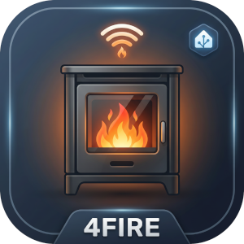

  

# Intégration Home Assistant - Poêle 4Heat (TiEmme) Wifi

Composant personnalisé pour piloter en local via Wi-Fi les poêles à granulés 4Fire et équipements basés sur l'électronique TiEmme Elettronica (cartes SY250 / protocoles 2WL et 2WC sur le port TCP 80) pilotés par l'application 4Heat.

## Matériel testé & Compatibilité

Ce module a été testé et validé sur :
- **Poêle à granulés :** **BlackLine T9**
- **Module Wi-Fi :** **4HEAT** (de **TiEmme Elettronica**)
- **Application mobile d'origine :** 4Heat / 4Fire

Il est compatible avec les poêles à granulés équipés d'une carte électronique TiEmme Elettronica (ex: SY250) et d'un module Wi-Fi répondant aux commandes locales sur le port 80 (protocole 2WL / 2WC).

## Fonctionnalités

- **Entité Climate (`climate.poele_4fire`)** :
  - Réglage précis de la température de consigne au dixième de degré (ex: 21.5 °C).
  - Affichage en direct de la température ambiante mesurée par la sonde.
  - Modes HVAC : `off` (Éteint) et `heat` (Allumé / En chauffe).
  - Actions détaillées : `preheating` (Contrôle, Chargement, Flamme), `heating` (Travail, Modulation), `off` (Éteint).
  - Support complet des cartes Lovelace et de la carte **Scheduler** (`supported_features: 385`).

- **Capteurs dédiés (`sensor`)** :
  - Température des fumées (°C)
  - Puissance active (ex: P1 à P5)
  - État détaillé (Préchauffage, Allumage, Modulation, Standby, etc.)
  - Horloge interne du poêle

## Installation

### Option 1 : Via HACS (Recommandé)

#### Installation en un clic :
Cliquez simplement sur ce bouton pour ouvrir directement le dépôt dans votre HACS :

#### Installation manuelle dans HACS :
1. Ouvrez **HACS** dans votre Home Assistant.
2. Cliquez sur les 3 points en haut à droite > **Dépôts personnalisés**.
3. Ajoutez l'URL : `https://github.com/M0m0z3b10n/ha-poele-4fire` avec la catégorie **Intégration**.
4. Cliquez sur **Télécharger**, puis redémarrez Home Assistant.

### Option 2 : Installation manuelle

Copiez le dossier `custom_components/poele_4fire` dans le répertoire `config/custom_components/` de votre serveur Home Assistant, puis redémarrez Home Assistant.

## Configuration

Rendez-vous dans **Paramètres** > **Appareils et services** > **Ajouter une intégration** :
1. Recherchez **Poêle 4Heat (TiEmme) Wifi** (ou tapez `4heat`).
2. Indiquez l'adresse IP locale de votre poêle (ex: `192.168.0.5`) et le port (`80`).
3. Validez : l'appareil et l'ensemble de ses entités sont créés automatiquement.

## Licence

Distribué sous licence MIT.
